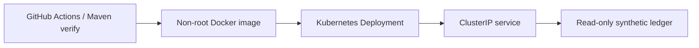

# Java Ledger Service | CI and Kubernetes

An independently implemented Spring Boot 4.1 / Java 21 microservice for a synthetic FinTech ledger. It is read-only and uses two fictional entries; no real financial transactions, customer data, or private course source code are included.



API: `GET /healthz`, `GET /readyz`, `GET /api/ledger`. Amounts are integer cents; the synthetic balance is EUR 100.00. The service does not implement a database or financial accounting controls.

## Local verification

```bash
mvn -B verify
docker build -t java-ledger:local .
docker run --rm -p 127.0.0.1:8080:8080 java-ledger:local
```

The Docker build also runs Maven tests, so a locally installed JDK is optional. Query `curl http://127.0.0.1:8080/api/ledger`.

## Local Kubernetes

```bash
kind create cluster --name java-lab --image kindest/node:v1.34.3 --kubeconfig ./java-lab.kubeconfig
kind load docker-image --name java-lab java-ledger:local
kubectl --kubeconfig ./java-lab.kubeconfig create namespace java-lab
kubectl --kubeconfig ./java-lab.kubeconfig -n java-lab apply -k k8s
kubectl --kubeconfig ./java-lab.kubeconfig -n java-lab rollout status deployment/java-api
kubectl --kubeconfig ./java-lab.kubeconfig -n java-lab port-forward service/java-api 18085:8080
```

For ARM64 multi-platform import issues use `docker image save --platform linux/arm64 -o java-ledger.tar java-ledger:local` and `kind load image-archive --name java-lab java-ledger.tar`. Delete only the disposable cluster with `kind delete cluster --name java-lab --kubeconfig ./java-lab.kubeconfig`.

## Verified 26 November 2026

Maven verify passed two HTTP integration tests inside the Docker builder. The real non-root Docker container returned the expected ledger; a Kind v1.34.3 deployment reached two Ready replicas and returned the same result over its ClusterIP service. The CI workflow builds and validates only. MySQL persistence, Jenkins, SonarQube, Argo CD promotion and production accounting remain follow-up milestones; no cloud resources were provisioned.
